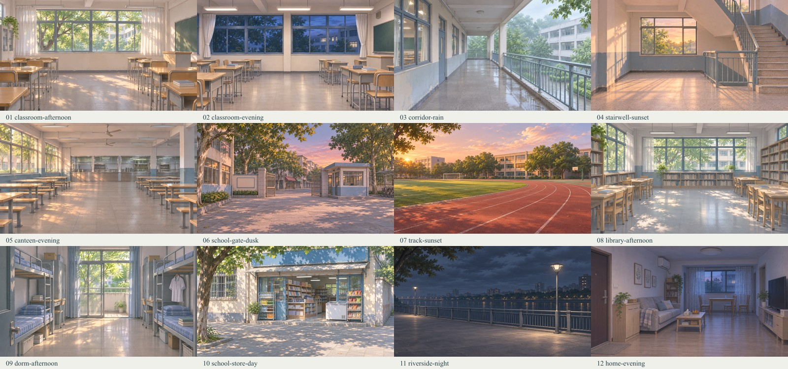

# 许映雪 · 校园对话素材

22 张透明立绘、12 张场景背景，以及可直接嵌入聊天的对话代码。男主复用仓库公共剪影；三页便签开场继续保留。

## 从这里开始

- **素材调用**：[外链使用规则](./外链使用规则.md) · [完整外链表 CSV](./外链对照表.csv) · [机器索引 JSON](./assets.json)
- **角色对话**：[对话使用规则](./对话使用规则.md)
- **代码输出**：[代码规范](./代码规范.md) · [可粘贴完整示例](./code/dialogue-example.txt)
- **给 AI 的完整规范**：[许映雪_对话区与素材外链使用规则.txt](./许映雪_对话区与素材外链使用规则.txt) · [同内容调用模板](./AI调用模板.txt)
- **原开场**：[三页便签代码和素材](./opening/README.md)

将对话规则、代码规范与索引交给后续生成器；已有普通角色卡正文无需整体改写。组件放在正文中间，前后保留充分叙述；示例假设玩家已经说过“我看看。”，不构成新增的固定剧情。

## 文件

| 目录 / 文件 | 内容 |
| --- | --- |
| `sprites/校服/` | 11 张校服 PNG |
| `sprites/日常装/` | 11 张本次日常装 PNG |
| `sprites/` 下 4 份说明 | 用户压缩包中的命名 CSV、动作说明、生成提示词、离线预览，原样保存 |
| `backgrounds/` | 12 张 JPG、总览、生成提示词 |
| `code/` | 可粘贴 HTML/TXT；单独浏览器预览页面 |
| `assets.json` | 35 个可调用条目：22角色 + 12背景 + 1复用男主 |
| `opening/` | 原有三页便签与图片、字体，保持独立 |

## 图像信息

立绘均为 1024×1536 RGBA PNG，保留原包所有字节。蓝色发带、黑长马尾为识别点；本次日常装为蓝白外套与深蓝褶裙，以压缩包为准。原图 alpha 数值范围 0～254，含透明像素，未强行改写边缘。

背景为 1672×941 的无人场景，使用内置 imagegen 分别生成，网页版本采用 JPEG quality 90、不裁切；完整提示词随库提供。

## 预览与使用

[桌面效果](./code/preview-desktop.png) · [手机效果](./code/preview-mobile.png)

`code/preview.html` 是完整浏览器文档，下载后打开可预览外链资源；`code/dialogue-example.txt` 才是用于粘贴的片段。`sprites/立绘预览.html` 使用相对路径，下载整个 sprites 目录后打开。

此项目不要求 GitHub Pages。GitHub Raw 提供素材和代码，通常不把 HTML 当网站执行。图片实际能否显示和 radio 能否工作，仍取决于目标聊天容器允许的 HTML/CSS；示例已在隔离 iframe 中检查。

示例保留用户参考中的 dg 基础样式、150% 画布、每步玩家图片和 {{user}} 变量，仅新增非末步的“点击继续 ▸”提示；最后一步仍为 1.2 秒后出现的重新开始。v00 HTML 通道的宏替换仍由平台负责，本规范不宣称已修复该兼容问题。

角色与背景优先 CDN；校服“06 好奇”本次 CDN 检查返回包大小限制，规范已指定该图使用 Raw 备用地址。玩家仍使用参考的固定原始 CDN 链接。
