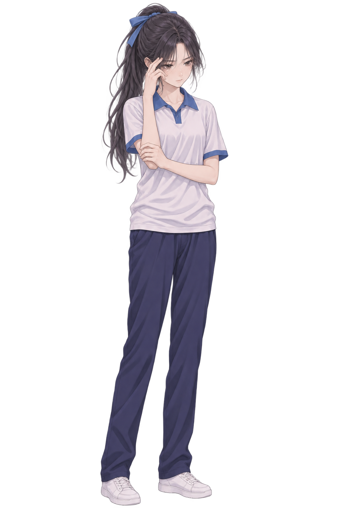
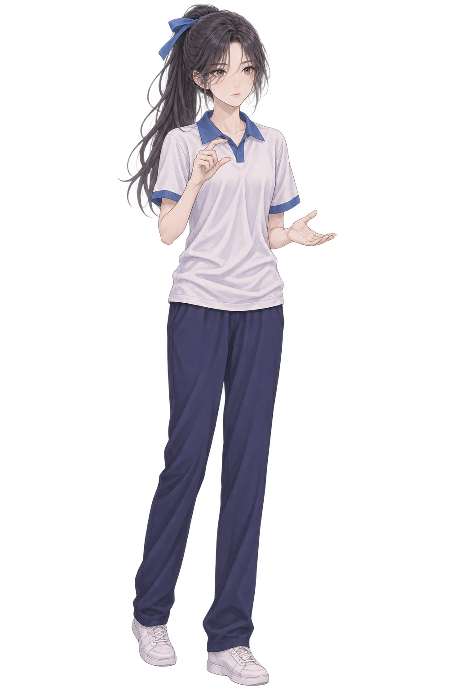

# 许映雪 · 代码规范（固定素材清单）

完整规范：[AI调用模板.txt](./AI调用模板.txt)；唯一允许的 src 集合：[src-whitelist.json](./src-whitelist.json)。角色和背景的 src 只能从清单整条选取；玩家始终使用 player-idle 的原链接。

## 二、素材地址的硬性规则

本规范只有 35 个可选素材条目：22 张许映雪立绘、12 个背景、1 张男主剪影。每个条目中的“素材内容”和“唯一完整 src”是一组不可拆分的对应关系。

1. 先根据正文选择具体条目 ID，再逐字复制该条目的完整 src，不能自行生成链接。
2. 不拼接根地址与文件名，不依据相似素材改写编号、服装、情绪、目录、扩展名或大小写。
3. 不编码、不解码、不替换 % 字符，不把中文与百分号编码互换；保持清单所写的完整字符串。
4. 不换域名，不改分支或提交号，不追加查询参数；不从历史版本、别的角色或印象中补链接。
5. dg-role 只能用第三节的 22 个立绘 src；dg-bg 只能用第六节的 12 个背景 src；dg-player 只能用第七节 player-idle 的 src。
6. 条目 ID 是查找标签，不是图片链接，不把 school-03 等 ID 放进 src。输出中不允许保留占位符、缩略地址、省略号或“自行替换”。
7. 校服和日常装的同名情绪是两个独立条目；换服装时必须重新选中对应条目并复制整条链接，不能只修改 URL 中的服装名称。
8. 没有合适的服装、情绪、动作或背景时，不生成组件，继续正文；不能创造“待机”“害羞”“白裙”等不存在的条目。
9. 确认图片加载失败时也不要猜新地址、换源或写自动回退脚本；本轮跳过组件，继续文字叙述，等待素材清单被明确更新。
10. 生成后逐一检查所有 img 的 src：必须与清单中某一个 src 完全相同，同时满足元素类型、服装、情绪和场景条件。仅域名正确或仅图片能打开都不算匹配。

本版每张图只给出一个允许使用的地址，没有备用地址或地址组合公式。src-whitelist.json 和素材内容与链接对应表.txt 是同一清单的独立副本；不需要 AI 再查目录推导路径。

## 八、原代码与样式保留要求

1. 下方模板是生成组件的基准。完整复制下方最新版 CSS；基础样式保持原样，仅按用户要求新增 .dg-hit::after 的“点击继续 ▸”提示。不再重设计、精简、换主题或新增其他覆盖样式。
2. 外层保持 <div class="dg">，style 为第一个子元素；保留原有 dg 系列类名。
3. 不使用 xy-dialogue、xyd- 或其他替代命名，不增加 max-width，不用 aspect-ratio 替换 padding-top:150%。
4. 不修改画布比例、立绘尺寸、左右位置、底部位置、对话框尺寸、颜色、字体、边框、圆角和内边距。
5. 角色与玩家保留 width:52.3%、height:52.3%、bottom:26.5%；左右位置保留 -2.3%。
6. 不改变透明度、灰度、亮度、位移、等比缩放和 transition:.45s ease。
7. 保留 dg-in 动画名称、重新开始按钮样式与 1.2 秒延迟。
8. 玩家 src 完全复用第七节固定链接，{{user}} 原样保留；背景使用第六节专属素材。
9. 图片 src 只能整条选取清单中与当前内容相符的固定值，不能手写或修改地址。其余允许随剧情修改的内容为角色 alt、说话人名称、台词、说话方类名、步骤数量和编号；玩家 src 始终固定。
10. 不把角色居中，不删除玩家，不新增旁白样式、页码或上一步导航；旁白与说明放在组件外。
11. 固定对话框的容量不通过改 CSS 解决；长台词拆成多步，不让文字被裁掉。
12. 台词作为文本正确转义 &、<、>；双引号属性中还需转义双引号。禁止脚本、事件属性、表单和本机路径。

## 九、多段编号与交互

1. 第 N 段 radio 共用 name="dgN"；第 M 步 id 为 dgN-M。
2. 同段 radio 共享 name 是正确分组方式；不同段 name 不得重复，所有步骤 id 全页唯一。
3. 第一段 dg1，第二段 dg2，之后顺延，不重复当前页面已有编号。
4. label 的 for 必须指向同段真实存在的步骤 id。
5. input.dg-s 必须紧邻其后的 div.dg-step，保留相邻选择器显示逻辑。
6. 每段第一步且仅第一步带 checked。
7. 许映雪说话使用 dg-speak-role，玩家说话使用 dg-speak-player，亮暗效果沿用原 CSS。
8. 普通步骤用 label.dg-hit 指向下一步，其 ::after 自动显示“点击继续 ▸”；末步不保留 dg-hit，换成 label.dg-restart，指向本段第一步。
9. 点击提示仅出现在非末步；原点击推进、末步按钮和 1.2 秒延迟出现逻辑不修改。
10. 增减步骤时，只增减完整 input 与步骤 div 配对结构，同步更新 id、name、for。

## 十、生成前后逐项检查

先确认许映雪在场、正文场景成立、服装与素材相符，再选择素材。

输出前执行“选条目—复制 src—填入对应 img—逐字核对”：
1. 每个 dg-role 的 src 都能在第三节找到唯一相同项，且该条目的服装、情绪、动作与本步一致。
2. 每个 dg-bg 的 src 都能在第六节找到唯一相同项，地点、天气和昼夜与正文一致。
3. 每个 dg-player 的 src 都与第七节 player-idle 完全相同。
4. 任一 src 没有精确匹配时，不提交这段组件；回到清单重新选取，不能靠改字符修补。
5. 核对中的 ID、规则、URL说明不输出为角色台词；组件内只保留实际 HTML/CSS。
6. 许映雪名牌正确，{{user}} 保留；每步玩家图保留。
7. 样式与第十一节最新版一致，非末步有“点击继续 ▸”，末步只有延迟出现的重新开始。
8. 编号全页唯一，第一步 checked，label 指向本段有效步骤。
9. 长台词已拆步，组件前后仍有充分正文，未替玩家决定下一步。

该清单要求精确引用，不以“保证链接有效”等说明代替核对。目标宿主须支持 HTML、style、input、label 和外链图片；不支持时继续正常正文。

## 示例

示例假设玩家已说“我看看。”；没有这句依据时不得照抄玩家台词。实际选择素材时同时核对内容和地址，不只模仿示例里 URL 的写法。

```html
<div class="dg">
<style>
.dg{position:relative;width:100%;padding-top:150%;overflow:hidden;background:#0b1220;isolation:isolate;font-family:system-ui,"Microsoft YaHei",sans-serif;font-size:clamp(12px,3.6vw,17px);line-height:1.7;color:#eaf1ff}
.dg *{box-sizing:border-box}
.dg-s{position:absolute;bottom:0;left:0;width:1px;height:1px;opacity:0;pointer-events:none}
.dg-step{position:absolute;top:0;right:0;bottom:0;left:0;display:none}
.dg-s:checked+.dg-step{display:block}
.dg-bg{position:absolute;top:0;left:0;width:100%;height:100%;object-fit:cover}
.dg-role,.dg-player{position:absolute;bottom:26.5%;width:52.3%;height:52.3%;object-fit:contain;object-position:bottom center;opacity:.34;filter:grayscale(.65) brightness(.7);transform:translateY(11.6%) scale(.94);transition:.45s ease}
.dg-role{left:-2.3%}
.dg-player{right:-2.3%}
.dg-speak-role .dg-role,.dg-speak-player .dg-player{opacity:1;filter:none;transform:translateY(-5.2%) scale(1);z-index:2}
.dg-box{position:absolute;left:4.5%;bottom:3%;width:91%;height:27.3%;padding:3.2% 4.1% 6.4%;border:1px solid rgba(124,199,255,.34);border-radius:12px;background:rgba(6,10,22,.82);overflow:hidden;z-index:3}
.dg-name{display:inline-block;margin-bottom:.5em;padding:.1em .8em;border-radius:999px;font-size:.92em;font-weight:700;color:#04121f;background:linear-gradient(135deg,#7cc7ff,#cdeaff)}
.dg-speak-player .dg-name{background:linear-gradient(135deg,#ff9ad5,#ffd3ee)}
.dg-text{margin:0;font-size:1em;line-height:1.7;text-shadow:0 2px 8px rgba(0,0,0,.6)}
.dg-hit{position:absolute;top:0;right:0;bottom:0;left:0;z-index:6;cursor:pointer}
.dg-hit::after{content:"点击继续 ▸";position:absolute;right:8.6%;bottom:4.8%;color:rgba(234,241,255,.68);font-size:clamp(11px,.78em,13px);letter-spacing:.06em;white-space:nowrap;pointer-events:none}
.dg-restart{position:absolute;left:50%;bottom:2%;transform:translateX(-50%);z-index:6;padding:.3em 1.2em;border:1px solid rgba(124,199,255,.6);border-radius:999px;background:rgba(14,24,44,.95);color:#eaf1ff;font-size:.82em;font-weight:700;letter-spacing:.1em;white-space:nowrap;cursor:pointer;animation:dg-in .35s ease 1.2s both}
@keyframes dg-in{from{opacity:0;visibility:hidden}to{opacity:1;visibility:visible}}
</style>

  <input class="dg-s" type="radio" name="dg1" id="dg1-1" checked>
  <div class="dg-step dg-speak-role">
    
    
    
    <div class="dg-box">
      <b class="dg-name">许映雪</b>
      <p class="dg-text">这道题……你有空看看吗？</p>
    </div>
    <label class="dg-hit" for="dg1-2" aria-label="继续"></label>
  </div>

  <input class="dg-s" type="radio" name="dg1" id="dg1-2">
  <div class="dg-step dg-speak-player">
    
    
    
    <div class="dg-box">
      <b class="dg-name">{{user}}</b>
      <p class="dg-text">我看看。</p>
    </div>
    <label class="dg-hit" for="dg1-3" aria-label="继续"></label>
  </div>

  <input class="dg-s" type="radio" name="dg1" id="dg1-3">
  <div class="dg-step dg-speak-role">
    
    
    
    <div class="dg-box">
      <b class="dg-name">许映雪</b>
      <p class="dg-text">这一步我总是算不对。你看，是从这里开始的吗？</p>
    </div>
    <label class="dg-restart" for="dg1-1">重新开始</label>
  </div>

</div>
```
