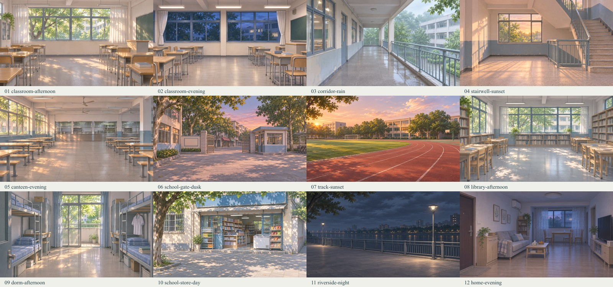

# 许映雪 · 素材外链使用规则

本项目提供 22 张透明角色立绘、12 张无人背景，并复用 1 张男主剪影。完整索引见 [assets.json](./assets.json)，表格版见 [外链对照表.csv](./外链对照表.csv)。原三页便签保留在 [opening/](./opening/README.md)。

## 直接使用

1. 先在索引里选定实际存在的 ID，再复制该条目的完整 `urls.raw`；不根据情绪中文自行猜路径。
2. 角色图片来自本次压缩包，校服和日常装各 11 张。PNG 原文件及 alpha 未修改；原包说明、命名备注、提示词和预览一并保留在 `sprites/`。
3. 背景网页文件为 1672×941 JPEG（约16:9），已经过高质量压缩，画面未裁切。生成提示词见 `backgrounds/生成提示词.json`。
4. 男主直接引用仓库公共 `玩家/立绘/玩家-待机立绘.png`，本项目没有复制或重画男主。
5. Raw 是当前示例使用的地址；jsDelivr 是同一文件的可选镜像。镜像与分支链接可能缓存，刚上传或替换时以实际访问结果为准。

## 地址格式

```text
GitHub Raw: https://raw.githubusercontent.com/karina-zzya/AI-assets/main/
jsDelivr:   https://cdn.jsdelivr.net/gh/karina-zzya/AI-assets@main/
```

`github.com/.../blob/main/...` 是文件查看页，不能当作 img.src。中文路径在下表中已按路径段编码，直接复制；不要改大小写、编号、扩展名或再次编码百分号。

要锁定版本，将 Raw 的 `/main/` 或 jsDelivr 的 `@main/` 替换为已存在的提交 SHA。不要删除或移动已被对话引用的旧文件。

## 22 张角色立绘

| ID | 服装 / 情绪 | GitHub Raw | jsDelivr |
| --- | --- | --- | --- |
| `school-01` | 校服·疑惑 | [PNG](https://raw.githubusercontent.com/karina-zzya/AI-assets/main/xuyingxue/sprites/%E6%A0%A1%E6%9C%8D/%E8%AE%B8%E6%98%A0%E9%9B%AA_%E6%A0%A1%E6%9C%8D_01_%E7%96%91%E6%83%91.png) | [PNG](https://cdn.jsdelivr.net/gh/karina-zzya/AI-assets@main/xuyingxue/sprites/%E6%A0%A1%E6%9C%8D/%E8%AE%B8%E6%98%A0%E9%9B%AA_%E6%A0%A1%E6%9C%8D_01_%E7%96%91%E6%83%91.png) |
| `school-02` | 校服·微笑 | [PNG](https://raw.githubusercontent.com/karina-zzya/AI-assets/main/xuyingxue/sprites/%E6%A0%A1%E6%9C%8D/%E8%AE%B8%E6%98%A0%E9%9B%AA_%E6%A0%A1%E6%9C%8D_02_%E5%BE%AE%E7%AC%91.png) | [PNG](https://cdn.jsdelivr.net/gh/karina-zzya/AI-assets@main/xuyingxue/sprites/%E6%A0%A1%E6%9C%8D/%E8%AE%B8%E6%98%A0%E9%9B%AA_%E6%A0%A1%E6%9C%8D_02_%E5%BE%AE%E7%AC%91.png) |
| `school-03` | 校服·蹙眉 | [PNG](https://raw.githubusercontent.com/karina-zzya/AI-assets/main/xuyingxue/sprites/%E6%A0%A1%E6%9C%8D/%E8%AE%B8%E6%98%A0%E9%9B%AA_%E6%A0%A1%E6%9C%8D_03_%E8%B9%99%E7%9C%89.png) | [PNG](https://cdn.jsdelivr.net/gh/karina-zzya/AI-assets@main/xuyingxue/sprites/%E6%A0%A1%E6%9C%8D/%E8%AE%B8%E6%98%A0%E9%9B%AA_%E6%A0%A1%E6%9C%8D_03_%E8%B9%99%E7%9C%89.png) |
| `school-04` | 校服·暗暗生气 | [PNG](https://raw.githubusercontent.com/karina-zzya/AI-assets/main/xuyingxue/sprites/%E6%A0%A1%E6%9C%8D/%E8%AE%B8%E6%98%A0%E9%9B%AA_%E6%A0%A1%E6%9C%8D_04_%E6%9A%97%E6%9A%97%E7%94%9F%E6%B0%94.png) | [PNG](https://cdn.jsdelivr.net/gh/karina-zzya/AI-assets@main/xuyingxue/sprites/%E6%A0%A1%E6%9C%8D/%E8%AE%B8%E6%98%A0%E9%9B%AA_%E6%A0%A1%E6%9C%8D_04_%E6%9A%97%E6%9A%97%E7%94%9F%E6%B0%94.png) |
| `school-05` | 校服·闹别扭 | [PNG](https://raw.githubusercontent.com/karina-zzya/AI-assets/main/xuyingxue/sprites/%E6%A0%A1%E6%9C%8D/%E8%AE%B8%E6%98%A0%E9%9B%AA_%E6%A0%A1%E6%9C%8D_05_%E9%97%B9%E5%88%AB%E6%89%AD.png) | [PNG](https://cdn.jsdelivr.net/gh/karina-zzya/AI-assets@main/xuyingxue/sprites/%E6%A0%A1%E6%9C%8D/%E8%AE%B8%E6%98%A0%E9%9B%AA_%E6%A0%A1%E6%9C%8D_05_%E9%97%B9%E5%88%AB%E6%89%AD.png) |
| `school-06` | 校服·好奇 | [PNG](https://raw.githubusercontent.com/karina-zzya/AI-assets/main/xuyingxue/sprites/%E6%A0%A1%E6%9C%8D/%E8%AE%B8%E6%98%A0%E9%9B%AA_%E6%A0%A1%E6%9C%8D_06_%E5%A5%BD%E5%A5%87.png) | [PNG](https://cdn.jsdelivr.net/gh/karina-zzya/AI-assets@main/xuyingxue/sprites/%E6%A0%A1%E6%9C%8D/%E8%AE%B8%E6%98%A0%E9%9B%AA_%E6%A0%A1%E6%9C%8D_06_%E5%A5%BD%E5%A5%87.png) |
| `school-07` | 校服·偷笑 | [PNG](https://raw.githubusercontent.com/karina-zzya/AI-assets/main/xuyingxue/sprites/%E6%A0%A1%E6%9C%8D/%E8%AE%B8%E6%98%A0%E9%9B%AA_%E6%A0%A1%E6%9C%8D_07_%E5%81%B7%E7%AC%91.png) | [PNG](https://cdn.jsdelivr.net/gh/karina-zzya/AI-assets@main/xuyingxue/sprites/%E6%A0%A1%E6%9C%8D/%E8%AE%B8%E6%98%A0%E9%9B%AA_%E6%A0%A1%E6%9C%8D_07_%E5%81%B7%E7%AC%91.png) |
| `school-08` | 校服·认真 | [PNG](https://raw.githubusercontent.com/karina-zzya/AI-assets/main/xuyingxue/sprites/%E6%A0%A1%E6%9C%8D/%E8%AE%B8%E6%98%A0%E9%9B%AA_%E6%A0%A1%E6%9C%8D_08_%E8%AE%A4%E7%9C%9F.png) | [PNG](https://cdn.jsdelivr.net/gh/karina-zzya/AI-assets@main/xuyingxue/sprites/%E6%A0%A1%E6%9C%8D/%E8%AE%B8%E6%98%A0%E9%9B%AA_%E6%A0%A1%E6%9C%8D_08_%E8%AE%A4%E7%9C%9F.png) |
| `school-09` | 校服·严肃 | [PNG](https://raw.githubusercontent.com/karina-zzya/AI-assets/main/xuyingxue/sprites/%E6%A0%A1%E6%9C%8D/%E8%AE%B8%E6%98%A0%E9%9B%AA_%E6%A0%A1%E6%9C%8D_09_%E4%B8%A5%E8%82%83.png) | [PNG](https://cdn.jsdelivr.net/gh/karina-zzya/AI-assets@main/xuyingxue/sprites/%E6%A0%A1%E6%9C%8D/%E8%AE%B8%E6%98%A0%E9%9B%AA_%E6%A0%A1%E6%9C%8D_09_%E4%B8%A5%E8%82%83.png) |
| `school-10` | 校服·生气 | [PNG](https://raw.githubusercontent.com/karina-zzya/AI-assets/main/xuyingxue/sprites/%E6%A0%A1%E6%9C%8D/%E8%AE%B8%E6%98%A0%E9%9B%AA_%E6%A0%A1%E6%9C%8D_10_%E7%94%9F%E6%B0%94.png) | [PNG](https://cdn.jsdelivr.net/gh/karina-zzya/AI-assets@main/xuyingxue/sprites/%E6%A0%A1%E6%9C%8D/%E8%AE%B8%E6%98%A0%E9%9B%AA_%E6%A0%A1%E6%9C%8D_10_%E7%94%9F%E6%B0%94.png) |
| `school-11` | 校服·害怕 | [PNG](https://raw.githubusercontent.com/karina-zzya/AI-assets/main/xuyingxue/sprites/%E6%A0%A1%E6%9C%8D/%E8%AE%B8%E6%98%A0%E9%9B%AA_%E6%A0%A1%E6%9C%8D_11_%E5%AE%B3%E6%80%95.png) | [PNG](https://cdn.jsdelivr.net/gh/karina-zzya/AI-assets@main/xuyingxue/sprites/%E6%A0%A1%E6%9C%8D/%E8%AE%B8%E6%98%A0%E9%9B%AA_%E6%A0%A1%E6%9C%8D_11_%E5%AE%B3%E6%80%95.png) |
| `casual-01` | 日常装·疑惑 | [PNG](https://raw.githubusercontent.com/karina-zzya/AI-assets/main/xuyingxue/sprites/%E6%97%A5%E5%B8%B8%E8%A3%85/%E8%AE%B8%E6%98%A0%E9%9B%AA_%E6%97%A5%E5%B8%B8%E8%A3%85_01_%E7%96%91%E6%83%91.png) | [PNG](https://cdn.jsdelivr.net/gh/karina-zzya/AI-assets@main/xuyingxue/sprites/%E6%97%A5%E5%B8%B8%E8%A3%85/%E8%AE%B8%E6%98%A0%E9%9B%AA_%E6%97%A5%E5%B8%B8%E8%A3%85_01_%E7%96%91%E6%83%91.png) |
| `casual-02` | 日常装·微笑 | [PNG](https://raw.githubusercontent.com/karina-zzya/AI-assets/main/xuyingxue/sprites/%E6%97%A5%E5%B8%B8%E8%A3%85/%E8%AE%B8%E6%98%A0%E9%9B%AA_%E6%97%A5%E5%B8%B8%E8%A3%85_02_%E5%BE%AE%E7%AC%91.png) | [PNG](https://cdn.jsdelivr.net/gh/karina-zzya/AI-assets@main/xuyingxue/sprites/%E6%97%A5%E5%B8%B8%E8%A3%85/%E8%AE%B8%E6%98%A0%E9%9B%AA_%E6%97%A5%E5%B8%B8%E8%A3%85_02_%E5%BE%AE%E7%AC%91.png) |
| `casual-03` | 日常装·蹙眉 | [PNG](https://raw.githubusercontent.com/karina-zzya/AI-assets/main/xuyingxue/sprites/%E6%97%A5%E5%B8%B8%E8%A3%85/%E8%AE%B8%E6%98%A0%E9%9B%AA_%E6%97%A5%E5%B8%B8%E8%A3%85_03_%E8%B9%99%E7%9C%89.png) | [PNG](https://cdn.jsdelivr.net/gh/karina-zzya/AI-assets@main/xuyingxue/sprites/%E6%97%A5%E5%B8%B8%E8%A3%85/%E8%AE%B8%E6%98%A0%E9%9B%AA_%E6%97%A5%E5%B8%B8%E8%A3%85_03_%E8%B9%99%E7%9C%89.png) |
| `casual-04` | 日常装·暗暗生气 | [PNG](https://raw.githubusercontent.com/karina-zzya/AI-assets/main/xuyingxue/sprites/%E6%97%A5%E5%B8%B8%E8%A3%85/%E8%AE%B8%E6%98%A0%E9%9B%AA_%E6%97%A5%E5%B8%B8%E8%A3%85_04_%E6%9A%97%E6%9A%97%E7%94%9F%E6%B0%94.png) | [PNG](https://cdn.jsdelivr.net/gh/karina-zzya/AI-assets@main/xuyingxue/sprites/%E6%97%A5%E5%B8%B8%E8%A3%85/%E8%AE%B8%E6%98%A0%E9%9B%AA_%E6%97%A5%E5%B8%B8%E8%A3%85_04_%E6%9A%97%E6%9A%97%E7%94%9F%E6%B0%94.png) |
| `casual-05` | 日常装·闹别扭 | [PNG](https://raw.githubusercontent.com/karina-zzya/AI-assets/main/xuyingxue/sprites/%E6%97%A5%E5%B8%B8%E8%A3%85/%E8%AE%B8%E6%98%A0%E9%9B%AA_%E6%97%A5%E5%B8%B8%E8%A3%85_05_%E9%97%B9%E5%88%AB%E6%89%AD.png) | [PNG](https://cdn.jsdelivr.net/gh/karina-zzya/AI-assets@main/xuyingxue/sprites/%E6%97%A5%E5%B8%B8%E8%A3%85/%E8%AE%B8%E6%98%A0%E9%9B%AA_%E6%97%A5%E5%B8%B8%E8%A3%85_05_%E9%97%B9%E5%88%AB%E6%89%AD.png) |
| `casual-06` | 日常装·好奇 | [PNG](https://raw.githubusercontent.com/karina-zzya/AI-assets/main/xuyingxue/sprites/%E6%97%A5%E5%B8%B8%E8%A3%85/%E8%AE%B8%E6%98%A0%E9%9B%AA_%E6%97%A5%E5%B8%B8%E8%A3%85_06_%E5%A5%BD%E5%A5%87.png) | [PNG](https://cdn.jsdelivr.net/gh/karina-zzya/AI-assets@main/xuyingxue/sprites/%E6%97%A5%E5%B8%B8%E8%A3%85/%E8%AE%B8%E6%98%A0%E9%9B%AA_%E6%97%A5%E5%B8%B8%E8%A3%85_06_%E5%A5%BD%E5%A5%87.png) |
| `casual-07` | 日常装·偷笑 | [PNG](https://raw.githubusercontent.com/karina-zzya/AI-assets/main/xuyingxue/sprites/%E6%97%A5%E5%B8%B8%E8%A3%85/%E8%AE%B8%E6%98%A0%E9%9B%AA_%E6%97%A5%E5%B8%B8%E8%A3%85_07_%E5%81%B7%E7%AC%91.png) | [PNG](https://cdn.jsdelivr.net/gh/karina-zzya/AI-assets@main/xuyingxue/sprites/%E6%97%A5%E5%B8%B8%E8%A3%85/%E8%AE%B8%E6%98%A0%E9%9B%AA_%E6%97%A5%E5%B8%B8%E8%A3%85_07_%E5%81%B7%E7%AC%91.png) |
| `casual-08` | 日常装·认真 | [PNG](https://raw.githubusercontent.com/karina-zzya/AI-assets/main/xuyingxue/sprites/%E6%97%A5%E5%B8%B8%E8%A3%85/%E8%AE%B8%E6%98%A0%E9%9B%AA_%E6%97%A5%E5%B8%B8%E8%A3%85_08_%E8%AE%A4%E7%9C%9F.png) | [PNG](https://cdn.jsdelivr.net/gh/karina-zzya/AI-assets@main/xuyingxue/sprites/%E6%97%A5%E5%B8%B8%E8%A3%85/%E8%AE%B8%E6%98%A0%E9%9B%AA_%E6%97%A5%E5%B8%B8%E8%A3%85_08_%E8%AE%A4%E7%9C%9F.png) |
| `casual-09` | 日常装·严肃 | [PNG](https://raw.githubusercontent.com/karina-zzya/AI-assets/main/xuyingxue/sprites/%E6%97%A5%E5%B8%B8%E8%A3%85/%E8%AE%B8%E6%98%A0%E9%9B%AA_%E6%97%A5%E5%B8%B8%E8%A3%85_09_%E4%B8%A5%E8%82%83.png) | [PNG](https://cdn.jsdelivr.net/gh/karina-zzya/AI-assets@main/xuyingxue/sprites/%E6%97%A5%E5%B8%B8%E8%A3%85/%E8%AE%B8%E6%98%A0%E9%9B%AA_%E6%97%A5%E5%B8%B8%E8%A3%85_09_%E4%B8%A5%E8%82%83.png) |
| `casual-10` | 日常装·生气 | [PNG](https://raw.githubusercontent.com/karina-zzya/AI-assets/main/xuyingxue/sprites/%E6%97%A5%E5%B8%B8%E8%A3%85/%E8%AE%B8%E6%98%A0%E9%9B%AA_%E6%97%A5%E5%B8%B8%E8%A3%85_10_%E7%94%9F%E6%B0%94.png) | [PNG](https://cdn.jsdelivr.net/gh/karina-zzya/AI-assets@main/xuyingxue/sprites/%E6%97%A5%E5%B8%B8%E8%A3%85/%E8%AE%B8%E6%98%A0%E9%9B%AA_%E6%97%A5%E5%B8%B8%E8%A3%85_10_%E7%94%9F%E6%B0%94.png) |
| `casual-11` | 日常装·害怕 | [PNG](https://raw.githubusercontent.com/karina-zzya/AI-assets/main/xuyingxue/sprites/%E6%97%A5%E5%B8%B8%E8%A3%85/%E8%AE%B8%E6%98%A0%E9%9B%AA_%E6%97%A5%E5%B8%B8%E8%A3%85_11_%E5%AE%B3%E6%80%95.png) | [PNG](https://cdn.jsdelivr.net/gh/karina-zzya/AI-assets@main/xuyingxue/sprites/%E6%97%A5%E5%B8%B8%E8%A3%85/%E8%AE%B8%E6%98%A0%E9%9B%AA_%E6%97%A5%E5%B8%B8%E8%A3%85_11_%E5%AE%B3%E6%80%95.png) |

选图依据见 [对话使用规则](./对话使用规则.md)。没有“待机”“害羞”“哭泣”差分，不用别的角色或历史版本冒充。

## 12 个背景

| ID | 场景 | 适用情况 | GitHub Raw | jsDelivr |
| --- | --- | --- | --- | --- |
| `01-classroom-afternoon` | 教室·午后 | 留校、自习、窗边交谈；晴日、夏末 | [JPG](https://raw.githubusercontent.com/karina-zzya/AI-assets/main/xuyingxue/backgrounds/01-classroom-afternoon.jpg) | [JPG](https://cdn.jsdelivr.net/gh/karina-zzya/AI-assets@main/xuyingxue/backgrounds/01-classroom-afternoon.jpg) |
| `02-classroom-evening` | 教室·晚自习 | 晚自习、考后整理、放学前；室内灯亮、窗外入夜 | [JPG](https://raw.githubusercontent.com/karina-zzya/AI-assets/main/xuyingxue/backgrounds/02-classroom-evening.jpg) | [JPG](https://cdn.jsdelivr.net/gh/karina-zzya/AI-assets@main/xuyingxue/backgrounds/02-classroom-evening.jpg) |
| `03-corridor-rain` | 教学楼走廊·雨天 | 等雨停、课间、并肩走路；雨天或雨后 | [JPG](https://raw.githubusercontent.com/karina-zzya/AI-assets/main/xuyingxue/backgrounds/03-corridor-rain.jpg) | [JPG](https://cdn.jsdelivr.net/gh/karina-zzya/AI-assets@main/xuyingxue/backgrounds/03-corridor-rain.jpg) |
| `04-stairwell-sunset` | 楼梯转角·日落 | 上下楼、短暂停留、放学；夕阳 | [JPG](https://raw.githubusercontent.com/karina-zzya/AI-assets/main/xuyingxue/backgrounds/04-stairwell-sunset.jpg) | [JPG](https://cdn.jsdelivr.net/gh/karina-zzya/AI-assets@main/xuyingxue/backgrounds/04-stairwell-sunset.jpg) |
| `05-canteen-evening` | 食堂·傍晚 | 留校吃饭、饭前饭后交流；傍晚、食堂空闲时 | [JPG](https://raw.githubusercontent.com/karina-zzya/AI-assets/main/xuyingxue/backgrounds/05-canteen-evening.jpg) | [JPG](https://cdn.jsdelivr.net/gh/karina-zzya/AI-assets@main/xuyingxue/backgrounds/05-canteen-evening.jpg) |
| `06-school-gate-dusk` | 校门·黄昏 | 离校、等人、返校；黄昏 | [JPG](https://raw.githubusercontent.com/karina-zzya/AI-assets/main/xuyingxue/backgrounds/06-school-gate-dusk.jpg) | [JPG](https://cdn.jsdelivr.net/gh/karina-zzya/AI-assets@main/xuyingxue/backgrounds/06-school-gate-dusk.jpg) |
| `07-track-sunset` | 操场·夕阳 | 体育课后、散步、听歌；夕阳 | [JPG](https://raw.githubusercontent.com/karina-zzya/AI-assets/main/xuyingxue/backgrounds/07-track-sunset.jpg) | [JPG](https://cdn.jsdelivr.net/gh/karina-zzya/AI-assets@main/xuyingxue/backgrounds/07-track-sunset.jpg) |
| `08-library-afternoon` | 阅览室·午后 | 借书、自习、查资料；日间 | [JPG](https://raw.githubusercontent.com/karina-zzya/AI-assets/main/xuyingxue/backgrounds/08-library-afternoon.jpg) | [JPG](https://cdn.jsdelivr.net/gh/karina-zzya/AI-assets@main/xuyingxue/backgrounds/08-library-afternoon.jpg) |
| `09-dorm-afternoon` | 男生宿舍·午后 | 男主留校日常、午睡后；男主空间；不默认许映雪在场 | [JPG](https://raw.githubusercontent.com/karina-zzya/AI-assets/main/xuyingxue/backgrounds/09-dorm-afternoon.jpg) | [JPG](https://cdn.jsdelivr.net/gh/karina-zzya/AI-assets@main/xuyingxue/backgrounds/09-dorm-afternoon.jpg) |
| `10-school-store-day` | 小卖部·白天 | 买饮料文具、放学顺路；白天 | [JPG](https://raw.githubusercontent.com/karina-zzya/AI-assets/main/xuyingxue/backgrounds/10-school-store-day.jpg) | [JPG](https://cdn.jsdelivr.net/gh/karina-zzya/AI-assets@main/xuyingxue/backgrounds/10-school-store-day.jpg) |
| `11-riverside-night` | 江边步道·夜晚 | 散步、交谈；明确跳时后可用于重逢；阴云无月；不自动触发毕业剧情 | [JPG](https://raw.githubusercontent.com/karina-zzya/AI-assets/main/xuyingxue/backgrounds/11-riverside-night.jpg) | [JPG](https://cdn.jsdelivr.net/gh/karina-zzya/AI-assets@main/xuyingxue/backgrounds/11-riverside-night.jpg) |
| `12-home-evening` | 男主家·傍晚 | 回家、等待家人、安静独处；男主家庭空间；不默认许映雪在场 | [JPG](https://raw.githubusercontent.com/karina-zzya/AI-assets/main/xuyingxue/backgrounds/12-home-evening.jpg) | [JPG](https://cdn.jsdelivr.net/gh/karina-zzya/AI-assets@main/xuyingxue/backgrounds/12-home-evening.jpg) |



## 复用男主

| ID | 内容 | GitHub Raw | jsDelivr |
| --- | --- | --- | --- |
| `player-idle` | 通用男主待机剪影 | [PNG](https://raw.githubusercontent.com/karina-zzya/AI-assets/main/%E7%8E%A9%E5%AE%B6/%E7%AB%8B%E7%BB%98/%E7%8E%A9%E5%AE%B6-%E5%BE%85%E6%9C%BA%E7%AB%8B%E7%BB%98.png) | [PNG](https://cdn.jsdelivr.net/gh/karina-zzya/AI-assets@main/%E7%8E%A9%E5%AE%B6/%E7%AB%8B%E7%BB%98/%E7%8E%A9%E5%AE%B6-%E5%BE%85%E6%9C%BA%E7%AB%8B%E7%BB%98.png) |

男主剪影可关闭：删除舞台内对应的 `xyd-player` 图片元素即可；无需生成新素材。

## 嵌入与失败处理

- 立绘使用 `` 加 `object-fit:contain`，保留透明背景和完整比例；背景可用 `object-fit:cover`。
- 对话片段内不放图片 Base64、不引用本机路径、不运行脚本。复制 [完整示例](./code/dialogue-example.txt) 后只替换已确认的素材、台词和唯一编号。
- 若外链访问失败，先检查完整URL与文件名，再手动换同条目的镜像。图片失败不应改变人物情绪或推进剧情。
- Raw 地址打开 HTML 通常显示源码；嵌入时复制源码，不把代码文件地址塞入 img 标签。
- `{{user}}` 的替换由聊天宿主负责，与图床外链无关；示例使用“你”避免依赖替换。详见 [代码规范](./代码规范.md)。
